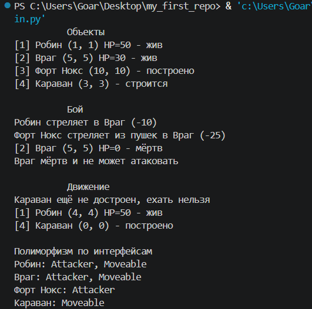

<p align="center"><b><i>Лабораторная работа 2</i></b></p>  
<p align="center"><b><i>«Основы ООП: иерархия классов для пошаговой стратегии»</i></b></p>

*Цель: Практически освоить основы объектно-ориентированного программирования: наследование, абстрактные классы, интерфейсы, инкапсуляцию и полиморфизм. Для этого необходимо реализовать иерархию игровых объектов пошаговой стратегии.* 

Постановка задачи  
Необходимо реализовать классы GameObject, Unit, Archer, Building, Fort, MobileHouse и интерфейсы Attacker и Moveable. Какие классы будут абстрактными, а какие определены полностью, студент выбирает самостоятельно.

Диаграмма классов

                    GameObject (abstract)
                    /                   \
             Building (abstract)     Unit (abstract)
              /          \                |
          Fort        MobileHouse       Archer
           |               |            /     \
       Attacker        Moveable    Attacker  Moveable
Attacker и Moveable — интерфейсы. Их реализуют Fort (Attacker), MobileHouse (Moveable) и Archer (оба). Имя MobileHome с диаграммы оставлено как псевдоним класса MobileHouse.

Описание классов  
| Класс | Тип | Назначение | Методы |
| :--- | :--- | :--- | :--- |
| Attacker | интерфейс | Может атаковать юнитов | attack(unit) |
| Moveable | интерфейс | Может перемещаться | move(x, y) |
| GameObject | абстрактный класс | Базовая информация об объекте | get_id, get_name, get_x, get_y, describe* |
| Unit | абстрактный класс | Управляемый юнит со здоровьем | is_alive, get_hp, receive_damage |
| Archer | конкретный класс | Лучник | attack, move |
| Building | абстрактный класс | Постройка | is_built, finish_construction |
| Fort | конкретный класс | Крепость с пушками | attack |
| MobileHouse | конкретный класс | Дом на колёсах | move |

Структура проекта

```text
lab2/
├── game_objects.py  # все классы
└── main.py          # демонстрация
```
**Результат запуска**



Fort и Archer атакуют одинаково, через Attacker.attack(unit), хотя находятся в разных ветках иерархии. Это и есть полиморфизм.

---

**Вывод**
В ходе работы на Python реализована иерархия классов с абстрактными классами и интерфейсами. Закреплены наследование, инкапсуляция и полиморфизм, а множественное наследование применено только для интерфейсов.
