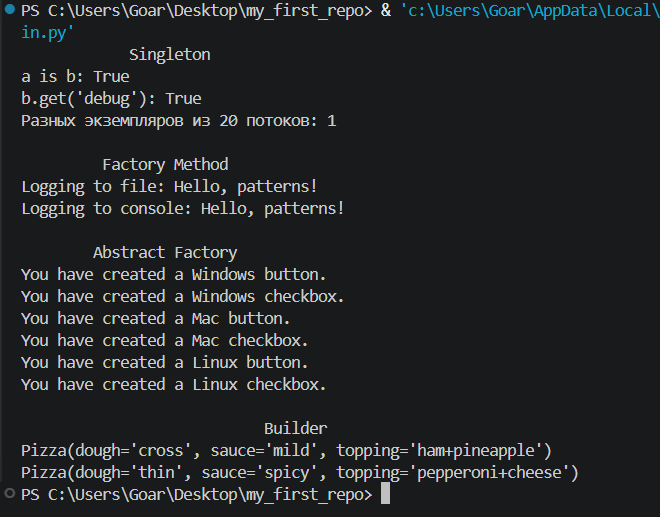

<p align="center"><b><i>Лабораторная работа 3</i></b></p>  
<p align="center"><b><i>«Порождающие паттерны проектирования»</i></b></p>

*Цель: Изучить порождающие паттерны проектирования и реализовать на Python паттерны Singleton, Factory Method, Abstract Factory и Builder.* 

*Постановка задачи*  
Реализовать четыре паттерна: Singleton (одиночка), Factory Method (фабричный метод), Abstract Factory (абстрактная фабрика) и Builder (строитель). За основу взяты примеры из лекции (логгеры, GUI-элементы, пицца), переписанные с Java на Python. Singleton реализован на примере конфигурации приложения. В Abstract Factory добавлено семейство Linux, чтобы показать расширяемость.


*Порождающие паттерны*   
Порождающие паттерны определяют механизмы создания объектов, повышая гибкость и возможность повторного использования кода. Остальные два вида паттернов — структурные (составление объектов в более крупные структуры) и поведенческие (взаимодействие объектов и распределение обязанностей).

**Singleton (Одиночка)**
**Назначение.** гарантирует, что у класса есть только один экземпляр, и предоставляет глобальную точку доступа к нему.
**Когда применять.** когда нужно контролировать доступ к общему ресурсу: конфигурации, файлу, подключению к базе данных.
**Участники и реализация:**  
* 	Класс `AppConfig` (файл `singleton.py`) хранит единственный экземпляр в атрибуте класса _instance.
*	Метод `__new__` создаёт объект только при первом обращении и возвращает его же при всех последующих.
*	Начальные настройки задаются в момент создания, поэтому повторных инициализаций нет. Метод `get_instance()` даёт явную точку доступа.

**Factory Method (Фабричный метод)**
**Назначение.** определяет интерфейс создания объекта, но позволяет подклассам решать, какой класс создавать.
**Когда применять.** когда заранее неизвестно, объекты каких типов понадобятся, и нужно добавлять новые типы без изменения существующего кода.
**Участники и реализация:**
*	Продукт: интерфейс `Logger`; конкретные продукты `FileLogger` и `ConsoleLogger`.
*	Создатель: абстрактный класс `LoggerFactory` с абстрактным фабричным методом `create_logger()` и методом `log_message()`, который использует фабричный метод.
*	Конкретные создатели: `FileLoggerFactory` и `ConsoleLoggerFactory`, каждый возвращает свой тип логгера.

**Abstract Factory (Абстрактная фабрика)**
**Назначение.** предоставляет интерфейс для создания семейств связанных объектов без указания их конкретных классов.
**Когда применять.** когда система должна работать с несколькими семействами продуктов, которые обязаны использоваться вместе (элементы интерфейса одной платформы).
**Участники и реализация:**
*	Абстрактные продукты: Button и Checkbox.
*	Конкретные продукты трёх семейств: Windows, Mac и Linux (WindowsButton, MacCheckbox и т. д.).
*	Абстрактная фабрика GUIFactory с методами create_button() и create_checkbox(); конкретные фабрики WindowsFactory, MacFactory, LinuxFactory.
*	Клиент Application получает фабрику в конструкторе и работает только с интерфейсами.

**Builder (Строитель)**
**Назначение.** позволяет создавать сложные объекты поэтапно, отделяя конструирование от представления.
**Когда применять.** когда у объекта много параметров или его создание состоит из нескольких шагов, а один и тот же процесс должен давать разные результаты.
**Участники и реализация:**
*	Продукт: Pizza с полями dough, sauce, topping.
*	Абстрактный строитель PizzaBuilder с шагами build_dough(), build_sauce(), build_topping() и get_result().
*	Конкретные строители: HawaiianPizzaBuilder и PepperoniPizzaBuilder.
*	Директор PizzaDirector задаёт порядок шагов в construct_pizza(), не зная, какая именно пицца получится.


*Структура проекта*
```text
lab3/
├── singleton.py
├── factory_method.py
├── abstract_factory.py
├── builder.py
└── main.py        # демонстрация всех паттернов
```

**Результат запуска**



---
 
**Вывод**
В ходе работы реализованы четыре порождающих паттерна на Python. Singleton даёт единственный потокобезопасный экземпляр конфигурации, Factory Method и Abstract Factory позволяют расширять систему новыми типами и семействами объектов без правки клиентского кода, а Builder разбивает создание сложного объекта на простые этапы.
